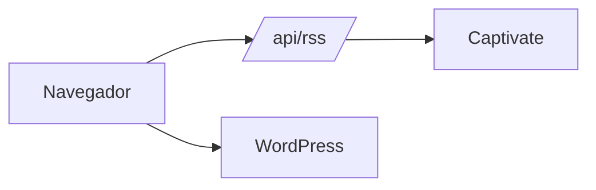

# Amplify Radio — Documentación Técnica y Guía de Handoff

> Sitio web de Amplify Radio (radio en línea, noticias y podcasts).
> Desarrollado por Aurigital sobre Next.js 14 (App Router).
> Versión del paquete: `0.1.0`

---

## Tabla de contenidos

1. [Documentación técnica del proyecto](#1-documentación-técnica-del-proyecto)
2. [Convenciones de código](#2-convenciones-de-código)
3. [Dependencias](#3-dependencias)
4. [Checklist de despliegue](#4-checklist-de-despliegue)
5. [Guía de Clean Code](#5-guía-de-clean-code)
6. [Buenas prácticas de Handoff](#6-buenas-prácticas-de-handoff)
7. [Guía de documentación técnica en Markdown](#7-guía-de-documentación-técnica-en-markdown)
8. [Deuda técnica y puntos de atención](#8-deuda-técnica-y-puntos-de-atención)

---

## 1. Documentación técnica del proyecto

### 1.1 Resumen

Amplify Radio es un sitio web que ofrece:

- **Radio en vivo** mediante un stream de Radiomast, con reproductor persistente en todo el sitio.
- **Podcasts** agregados desde feeds RSS de Captivate.fm (20 activos y 13 históricos).
- **Noticias** consumidas desde un WordPress headless (`amplify.aurigital.com`).
- Páginas institucionales (Nosotros, Amplifiers, Contacto) con formulario de contacto vía EmailJS.
- SEO (metadatos, JSON-LD, sitemap, robots, Open Graph) y analítica con Google Analytics 4.

### 1.2 Stack tecnológico

| Capa | Tecnología |
|---|---|
| Framework | Next.js 14.1.0 (App Router) |
| UI | React 18, Tailwind CSS 3.4 |
| Lenguajes | JavaScript (JSX) y TypeScript (TSX) mezclados |
| Íconos | `lucide-react`, `react-icons` |
| Carruseles | `react-slick` + `slick-carousel` |
| Parseo RSS | `xml2js` |
| Correo | `@emailjs/browser` |
| Analítica | `@next/third-parties` / gtag (GA4: `G-KQVY1DF7RP`) |
| Salida de build | `output: 'standalone'` |

### 1.3 Arquitectura general

```
                 ┌────────────────────────────┐
                 │        Navegador           │
                 │  (páginas 'use client')    │
                 └──────┬──────────┬──────────┘
                        │          │
        /api/rss (proxy)│          │ fetch directo
                        ▼          ▼
          ┌──────────────────┐  ┌────────────────────────────┐
          │ Next.js API Route│  │ WordPress REST API         │
          │  src/app/api/rss │  │ amplify.aurigital.com      │
          └────────┬─────────┘  │ /wp-json/wp/v2             │
                   │            └────────────────────────────┘
                   ▼
        ┌──────────────────────┐        ┌──────────────────────┐
        │ Feeds Captivate.fm   │        │ Stream Radiomast     │
        │ (directo → 4 proxies)│        │ (<audio> en cliente) │
        └──────────────────────┘        └──────────────────────┘
```

Flujo de datos:

- **Noticias:** `WordPressService` (clase estática) llama a la API REST de WordPress con `_embed` para traer imagen, categoría y autor en una sola petición.
- **Podcasts:** `RSSService` (singleton) obtiene los feeds a través de `/api/rss`, que intenta conexión directa y, si falla, recorre una lista de proxies CORS. Resultado parseado con `xml2js` y cacheado en memoria 30 minutos.
- **Reproductor:** `PlayerContext` mantiene el estado global (radio o episodio de podcast, cola, índice) y `RadioPlayer` lo renderiza.

### 1.4 Estructura de carpetas

```
amplify-radio/
├── lib/api.js                  # getPosts() legado (ver deuda técnica)
├── public/
│   ├── assets/
│   │   ├── about-us/           # imágenes de la página Nosotros
│   │   ├── autores/            # fotos de conductores
│   │   └── podcast/            # portadas locales de cada podcast (.avif)
│   └── isotipo.avif
├── src/
│   ├── app/
│   │   ├── (pages)/            # grupo de rutas (no afecta la URL)
│   │   │   ├── about-us/
│   │   │   ├── amplifiers/
│   │   │   ├── contact/
│   │   │   ├── news/ (+ [slug]/)
│   │   │   └── podcasts/ (+ [id]/)
│   │   ├── api/rss/route.ts    # proxy de feeds RSS
│   │   ├── layout.js           # layout raíz, GA4, preconnect
│   │   ├── page.jsx            # home
│   │   ├── sitemap.js · robots.js · opengraph-image.js · site.webmanifest
│   │   └── globals.css
│   ├── components/
│   │   ├── SEO/                # Breadcrumbs, JsonLd
│   │   ├── UI/                 # NewsCard, NewsCardGrid, PodcastCard
│   │   ├── about-us/ · contact/ · home/ · news/ · podcasts/
│   │   └── Navbar, Footer, RadioPlayer, SplashPage, AurigitalBar
│   ├── lib/
│   │   ├── PlayerContext.tsx   # estado global del reproductor
│   │   ├── SearchContext.tsx   # estado de búsqueda
│   │   ├── rssConfig.ts        # timeouts, reintentos, proxies
│   │   ├── rssService.ts       # lógica de podcasts (≈1100 líneas)
│   │   ├── wordpressService.ts # lógica de noticias
│   │   └── seo.js              # configuración y generadores de metadatos/schema
│   └── types/                  # podcast.ts, wordpress.ts
├── next.config.mjs · tailwind.config.js · tsconfig.json · jsconfig.json
└── postcss.config.js · postcss.config.mjs
```

### 1.5 Rutas

| Ruta | Archivo | Descripción |
|---|---|---|
| `/` | `src/app/page.jsx` | Home: hero, noticias por categoría, podcasts |
| `/news` | `(pages)/news/page.tsx` | Listado con filtros, búsqueda y paginación |
| `/news/[slug]` | `(pages)/news/[slug]/page.tsx` | Detalle de noticia, relacionadas, JSON-LD |
| `/podcasts` | `(pages)/podcasts/page.tsx` | Parrilla de podcasts y horarios |
| `/podcasts/[id]` | `(pages)/podcasts/[id]/page.tsx` | Detalle de un podcast y sus episodios |
| `/amplifiers` | `(pages)/amplifiers/page.tsx` | Conductores / equipo |
| `/about-us` | `(pages)/about-us/page.jsx` | Institucional |
| `/contact` | `(pages)/contact/page.jsx` | Formulario y mapa |
| `/api/rss` | `app/api/rss/route.ts` | Proxy de feeds (`?url=`) |
| `/sitemap.xml`, `/robots.txt` | `sitemap.js`, `robots.js` | SEO |

### 1.6 Integraciones externas

| Servicio | Uso | Ubicación en código |
|---|---|---|
| WordPress REST (`amplify.aurigital.com`) | Noticias, categorías, tags | `src/lib/wordpressService.ts` (`WORDPRESS_API_BASE`) |
| Captivate.fm | Feeds RSS y artwork de podcasts | `src/lib/rssService.ts` (`PODCAST_RSS_FEEDS`) |
| Radiomast | Stream de radio en vivo | `src/components/RadioPlayer.tsx` (`radioUrl`) |
| EmailJS | Envío del formulario de contacto | `src/components/contact/ContactForm.jsx` |
| Google Analytics 4 | Métricas | `src/app/layout.js` |
| Google Maps (embed) | Ubicación | `src/components/contact/Location.jsx` |
| Proxies CORS (allorigins, cors-anywhere, thingproxy, codetabs) | Fallback de feeds RSS | `src/lib/rssConfig.ts` |

Dominios de imágenes remotos permitidos en `next.config.mjs`: `amplify.aurigital.com` (`/wp-content/uploads/**`), `artwork.captivate.fm`, `cdn.captivate.fm`.

### 1.7 Configuración del servicio RSS

Valores en `src/lib/rssConfig.ts`:

| Parámetro | Valor | Nota |
|---|---|---|
| `REQUEST_TIMEOUT` | 8000 ms | por petición |
| `CACHE_DURATION` | 30 min | caché en memoria (se pierde al reiniciar) |
| `MAX_RETRIES` | 1 | |
| `RETRY_DELAY` | 200 ms | multiplicado por intento |

### 1.8 Cómo agregar o modificar contenido

**Agregar un podcast nuevo**

1. Añadir la URL del feed en `PODCAST_RSS_FEEDS` (`rssService.ts`) con `status: 'actual'` o `'historial'`.
2. Colocar la portada en `public/assets/podcast/<slug>.avif` y registrarla en `PODCAST_LOCAL_IMAGES`.
3. Si tiene conductores, registrar autores con `addPodcastAuthors` / configuración de autores y subir fotos a `public/assets/autores/`.
4. Verificar en `/podcasts` y en `/podcasts/<id>`.

**Cambiar el stream de radio:** modificar `radioUrl` en `RadioPlayer.tsx`.

**Cambiar metadatos globales / SEO:** editar `SEO_CONFIG` en `src/lib/seo.js`.

**Nuevo dominio de imágenes:** añadirlo a `images.remotePatterns` en `next.config.mjs`.

### 1.9 Seguridad y cabeceras

`next.config.mjs` define para todas las rutas: `X-Content-Type-Options: nosniff`, `X-Frame-Options: DENY`, `X-XSS-Protection`, `Referrer-Policy: origin-when-cross-origin`. Caché de `sitemap.xml` (1 h + SWR 24 h) y `robots.txt` (24 h).

### 1.10 Puesta en marcha local

Requisitos: Node.js 18.17 o superior (requerido por Next 14) y npm.

```bash
git clone <url-del-repositorio>
cd amplify-radio
npm install
npm run dev        # http://localhost:3000
```

Scripts disponibles:

| Script | Acción |
|---|---|
| `npm run dev` | Servidor de desarrollo |
| `npm run build` | Build de producción (`.next/standalone`) |
| `npm start` | Sirve el build |
| `npm run lint` | `next lint` |

El proyecto **no requiere variables de entorno** actualmente (ver sección 8).

---

## 2. Convenciones de código

Estas convenciones reflejan lo que ya hace el código y fijan reglas para lo nuevo.

### 2.1 Idioma

- **Código** (variables, funciones, tipos, archivos): inglés.
- **Textos de interfaz, comentarios y mensajes de commit**: español (es el idioma del producto y del equipo).

### 2.2 Nombres

| Elemento | Convención | Ejemplo |
|---|---|---|
| Componentes React | `PascalCase`, un componente por archivo | `PodcastCard.tsx` |
| Archivos de ruta Next | minúsculas según la convención del framework | `page.tsx`, `route.ts` |
| Carpetas de rutas | `kebab-case` | `about-us/` |
| Funciones y variables | `camelCase` | `getRelatedPosts` |
| Constantes de configuración | `UPPER_SNAKE_CASE` | `RSS_CONFIG`, `CACHE_DURATION` |
| Tipos e interfaces | `PascalCase` | `PodcastEpisode` |
| Hooks y contextos | `use…` / `…Context` | `usePlayer`, `PlayerContext` |
| Assets públicos | `kebab-case`, sin acentos ni espacios | `la-telarana.avif` |

### 2.3 TypeScript vs JavaScript

- **Todo archivo nuevo debe ser `.ts` / `.tsx`.** Los `.js` / `.jsx` existentes se migran de forma oportunista al tocarlos.
- `strict: true` está activo; no usar `any` sin justificación escrita.
- Los tipos compartidos viven en `src/types/`.
- Importar con alias `@/…` (apunta a `src/`) en lugar de rutas relativas profundas (`../../..`).

### 2.4 Componentes React

- Componentes funcionales con hooks; sin clases.
- Marcar `'use client'` solo cuando se necesite estado, efectos o APIs del navegador. Hoy todas las páginas son cliente; las nuevas deben partir como Server Components cuando sea posible.
- Props tipadas con `interface`; desestructurar en la firma.
- Un componente no debería superar ~200 líneas: extraer subcomponentes o hooks.
- Lógica de datos fuera del JSX (en `src/lib/` o en hooks), no dentro de los componentes de presentación.

### 2.5 Estilos

- Tailwind CSS como método principal; clases utilitarias directamente en el JSX.
- Fuentes definidas en `tailwind.config.js`: `font-jost` y `font-lexend`.
- Colores de marca: naranja `#E5754C` (themeColor) y fondo oscuro `#0a0a0a`. Cuando se repita un color más de dos veces, moverlo a `theme.extend.colors`.
- CSS global solo para resets o estilos de librerías de terceros (`globals.css`).
- Mobile-first: estilos base para móvil y `sm:`/`md:`/`lg:` para ampliar.

### 2.6 Imágenes y assets

- Formato **AVIF** para imágenes locales (ya es el estándar del repo).
- Usar `next/image` con dimensiones o `fill` y `alt` descriptivo.
- Sin acentos, `ñ` ni espacios en nombres de archivo (hoy existen `la-telaraña.avif` y `FrancinaDelgadoGómez.jpeg`; renombrar al refactorizar).

### 2.7 Formato

- Indentación de 2 espacios, comillas simples en JS/TS, punto y coma al final.
- Un solo `postcss.config` (ver sección 8).
- Se recomienda añadir Prettier y ESLint con reglas compartidas (ver sección 8).

### 2.8 Git

- **Ramas:** `main` (estable) y ramas por feature (`feature/<tema>`, `fix/<tema>`).
- **Commits:** mensajes cortos en español, en imperativo o descriptivos, con una sola intención por commit.
  Ejemplos del repo: `Fotos Alex y Emanuel`, `GA4`, `Cambio foto Flamingo`.
  Preferible: `Agregar podcast Travesía`, `Corregir caché de feeds RSS`.
- No commitear `node_modules`, `.next`, `.env*` ni archivos temporales (ya cubierto por `.gitignore`).
- Los cambios a `main` entran por Pull Request con al menos una revisión.

### 2.9 Comentarios y logs

- Comentar el **porqué**, no el qué.
- Eliminar `console.log` de depuración antes de producción. `route.ts` y `rssService.ts` contienen logs con emojis que deberían pasar a un logger con niveles o quedar solo en desarrollo.

---

## 3. Dependencias

Fuente: `package.json`. Instalar siempre con `npm install` para respetar `package-lock.json`.

### 3.1 Dependencias de producción

| Paquete | Versión | Para qué se usa | Observaciones |
|---|---|---|---|
| `next` | 14.1.0 | Framework, routing, SSR/SSG, API routes | Versión fija (sin `^`). Existen versiones 14.x posteriores con parches de seguridad |
| `react` / `react-dom` | ^18.2.0 | UI | |
| `@emailjs/browser` | ^4.4.1 | Envío de formulario de contacto | Se ejecuta en el cliente |
| `@next/third-parties` | ^14.1.0 | Integración con Google Analytics | Alinear con la versión de `next` |
| `xml2js` | ^0.6.2 | Parseo de feeds RSS | |
| `@types/xml2js` | ^0.4.14 | Tipos de `xml2js` | Está en `dependencies`; debería ir en `devDependencies` |
| `lucide-react` | ^0.525.0 | Íconos | Optimizado vía `optimizePackageImports` |
| `react-icons` | ^5.0.1 | Íconos (redes sociales, etc.) | Solapa con `lucide-react`; valorar unificar |
| `react-slick` | ^0.30.3 | Carruseles | Requiere `slick-carousel` |
| `slick-carousel` | ^1.8.1 | CSS/fuentes de slick | |

### 3.2 Dependencias de desarrollo

| Paquete | Versión | Uso |
|---|---|---|
| `typescript` | ^5.3.3 | Tipado |
| `@types/node`, `@types/react`, `@types/react-dom` | ^20.11.0 / ^18.2.0 | Tipos |
| `tailwindcss` | ^3.4.1 | Estilos |
| `postcss` | ^8.4.31 | Procesado CSS |
| `autoprefixer` | ^10.4.21 | Prefijos CSS |

### 3.3 Política para dependencias

1. Antes de añadir un paquete: comprobar si ya existe uno equivalente en el proyecto, su mantenimiento (última publicación) y su peso.
2. Instalar con versión exacta o `^` y **commitear siempre `package-lock.json`**.
3. Ejecutar `npm audit` de forma periódica y antes de cada despliegue.
4. Actualizar de a una dependencia mayor por vez, con build y prueba manual completas.
5. Eliminar paquetes sin uso (`npx depcheck`).

### 3.4 Servicios externos como dependencia operativa

El sitio depende de que estén disponibles: WordPress (`amplify.aurigital.com`), Captivate.fm, Radiomast, EmailJS y los proxies CORS públicos. Una caída de cualquiera degrada una sección concreta (noticias, podcasts, radio, contacto).

---

## 4. Checklist de despliegue

### 4.1 Antes de desplegar

**Código**
- [ ] Rama actualizada con `main` y sin conflictos.
- [ ] Pull Request revisado y aprobado.
- [ ] `npm install` limpio (sin errores ni cambios inesperados en `package-lock.json`).
- [ ] `npm run lint` sin errores.
- [ ] `npm run build` completa sin errores de TypeScript ni advertencias nuevas.
- [ ] Probado localmente con `npm run build && npm start` (no solo `npm run dev`).
- [ ] Sin `console.log` de depuración ni código comentado.
- [ ] `npm audit` revisado; vulnerabilidades altas/críticas evaluadas.

**Contenido y SEO**
- [ ] Títulos, descripciones y Open Graph correctos en las páginas modificadas.
- [ ] `sitemap.xml` y `robots.txt` responden correctamente.
- [ ] Imágenes en AVIF, con `alt`, y dominios nuevos añadidos a `remotePatterns`.

**Integraciones**
- [ ] WordPress responde: `https://amplify.aurigital.com/wp-json/wp/v2/posts?_embed&per_page=1`.
- [ ] Feeds de Captivate accesibles (probar 2–3 de `PODCAST_RSS_FEEDS`).
- [ ] Stream de Radiomast reproduce.
- [ ] Formulario de contacto envía y el correo llega.
- [ ] GA4 recibe eventos en tiempo real (ID `G-KQVY1DF7RP`).

### 4.2 Verificación funcional (smoke test)

- [ ] Home carga sin errores en consola.
- [ ] `/news`: filtros, búsqueda y paginación funcionan; abrir una noticia en `/news/<slug>`.
- [ ] `/podcasts`: carga la parrilla; abrir un podcast y reproducir un episodio.
- [ ] El reproductor persiste al navegar entre páginas; radio ↔ podcast cambia correctamente.
- [ ] `/amplifiers`, `/about-us`, `/contact` correctas.
- [ ] Probado en móvil (≈375 px), tablet y escritorio; en Chrome, Safari y Firefox.
- [ ] Lighthouse: rendimiento, accesibilidad y SEO sin regresiones.

### 4.3 Despliegue

El proyecto compila con `output: 'standalone'`, por lo que puede ejecutarse como servidor Node mínimo o contenedor.

```bash
npm ci
npm run build
# Opción A: servidor Next
npm start
# Opción B: standalone
node .next/standalone/server.js
```

Notas para el despliegue standalone: copiar también `public/` y `.next/static/` junto a `.next/standalone/` (Next no los incluye automáticamente). Definir `PORT` y `HOSTNAME` si es necesario.

- [ ] Versión de Node del entorno compatible (≥ 18.17).
- [ ] Servidor detrás de HTTPS con certificado válido.
- [ ] Dominio de producción coherente con `siteUrl` en `src/lib/seo.js` y las URLs de breadcrumbs en `news/[slug]/page.tsx`.
- [ ] Etiqueta/tag de Git creada para la versión desplegada.

### 4.4 Después de desplegar

- [ ] Repetir el smoke test sobre producción.
- [ ] Revisar logs del servidor durante los primeros minutos (en especial `/api/rss`).
- [ ] Validar datos estructurados (Rich Results Test) y vista previa social.
- [ ] Enviar/verificar `sitemap.xml` en Google Search Console.
- [ ] Confirmar GA4 en tiempo real.
- [ ] Comunicar el despliegue al equipo con versión y cambios.

### 4.5 Plan de rollback

1. Mantener disponible el build/imagen de la versión anterior.
2. Si falla el smoke test: volver al commit/tag anterior y redesplegar.
3. Documentar causa y corrección antes de reintentar.

---

## 5. Guía de Clean Code

Principios aplicados a este proyecto, con ejemplos de dónde aplican.

### 5.1 Nombres que expliquen la intención

```ts
// ❌
const d = Date.now() - c.timestamp;
if (d < 1800000) { ... }

// ✅
const cacheAgeMs = Date.now() - cached.timestamp;
if (cacheAgeMs < RSS_CONFIG.CACHE_DURATION) { ... }
```

Evitar números mágicos: usar constantes con nombre (como ya hace `RSS_CONFIG`).

### 5.2 Funciones pequeñas con una sola responsabilidad

Una función hace una cosa, a un solo nivel de abstracción. `rssService.ts` (~1100 líneas) mezcla configuración, mapeos de imágenes, parseo XML, caché y utilidades; conviene dividirlo:

```
rssService.ts
 ├── podcastFeeds.ts      # lista de feeds y estados
 ├── podcastImages.ts     # mapeo de imágenes locales
 ├── rssParser.ts         # xml → modelos de dominio
 ├── rssCache.ts          # caché con TTL
 └── rssService.ts        # orquestación
```

### 5.3 Evitar duplicación (DRY)

Si el mismo bloque aparece dos veces, extraerlo. Ejemplos a vigilar: iconos y enlaces de redes sociales repetidos en `Footer.jsx` y `FilterSidebar.tsx`; el enlace al media kit en `Footer.jsx` y `ContactForm.jsx`. Centralizar en una constante (`SOCIAL_LINKS`) o componente.

### 5.4 Configuración fuera de la lógica

Las URLs, IDs y claves no deben estar dentro de componentes. Mover a `src/lib/config.ts` o variables de entorno:

```ts
// src/lib/config.ts
export const CONFIG = {
  radioStreamUrl: process.env.NEXT_PUBLIC_RADIO_STREAM_URL!,
  wordpressApi: process.env.NEXT_PUBLIC_WP_API_URL!,
};
```

### 5.5 Manejo de errores explícito

- No tragar errores con `catch {}` vacíos; registrar o devolver un estado de error visible al usuario.
- Mostrar estados de carga, vacío y error en toda sección que dependa de red.
- Lanzar `Error` con mensajes útiles y contexto.

### 5.6 Separar datos, lógica y presentación

- Componentes de presentación reciben datos por props.
- Hooks personalizados (`usePodcasts`, `useNews`) encapsulan carga y estado.
- Servicios (`WordPressService`, `RSSService`) no conocen React.

### 5.7 Comentarios

- El buen código se explica solo; comentar decisiones, restricciones y razones no obvias (por ejemplo: *por qué* existen proxies de respaldo).
- No dejar código comentado: para eso está Git.
- Eliminar comentarios obsoletos; un comentario falso es peor que ninguno.

### 5.8 Tipado y contratos

- Modelar el dominio con tipos (`PodcastShow`, `PodcastEpisode`, `WordPressPost`).
- Evitar `any`; usar `unknown` y estrechar el tipo.
- Validar datos externos en el borde (respuesta de WordPress, XML de RSS) antes de usarlos.

### 5.9 Efectos secundarios y estado

- Minimizar estado global: hoy `PlayerContext` y `SearchContext` son suficientes.
- Derivar valores en lugar de duplicarlos en estado.
- Limpiar efectos (`useEffect` con cleanup) para listeners, timers y audio.

### 5.10 Regla del boy scout

> Deja el código un poco mejor de como lo encontraste.

Al tocar un archivo: renombrar lo confuso, borrar lo muerto, añadir tipos. Sin refactors masivos mezclados con cambios funcionales: commits separados.

### 5.11 Checklist rápido de revisión

- [ ] ¿Los nombres se entienden sin leer la implementación?
- [ ] ¿Cada función/componente hace una sola cosa?
- [ ] ¿Hay duplicación que pueda extraerse?
- [ ] ¿Hay valores fijos que deberían ser constantes o configuración?
- [ ] ¿Se manejan los estados de carga y error?
- [ ] ¿Hay `console.log`, código muerto o `any` innecesarios?
- [ ] ¿Es accesible (alt, labels, foco, contraste)?

---

## 6. Buenas prácticas de Handoff

El handoff es la transferencia de un proyecto (o de una parte) entre personas o equipos. Su objetivo: que quien recibe pueda trabajar con autonomía desde el primer día.

### 6.1 Antes de entregar

1. **Estado limpio:** rama integrada, sin cambios sin commitear, build y lint pasan.
2. **Documentación vigente:** este documento y el `README.md` reflejan la realidad (el README actual es la plantilla por defecto de `create-next-app` y debe reemplazarse por un resumen con enlace a esta guía).
3. **Accesos inventariados** (ver 6.3).
4. **Tareas pendientes registradas** en el gestor de tareas, no en la memoria de nadie.
5. **Decisiones documentadas:** qué se eligió, qué se descartó y por qué.

### 6.2 Contenido mínimo de un handoff

| Sección | Qué debe incluir |
|---|---|
| Contexto | Qué es el producto, quién lo usa, objetivos de negocio |
| Estado | Qué está terminado, en curso y pendiente |
| Arquitectura | Diagrama, integraciones, flujo de datos (sección 1) |
| Cómo ejecutarlo | Pasos exactos de instalación y arranque |
| Cómo desplegarlo | Checklist de despliegue (sección 4) |
| Deuda técnica | Problemas conocidos y su prioridad (sección 8) |
| Contactos | A quién preguntar por cada sistema externo |
| Accesos | Dónde se gestionan credenciales (sin escribirlas en el documento) |

### 6.3 Inventario de accesos (plantilla)

> No guardar contraseñas ni tokens en el repositorio. Registrar *dónde* están y *quién* los administra.

| Sistema | Qué se hace allí | Responsable | Dónde se gestionan las credenciales |
|---|---|---|---|
| Repositorio Git (GitHub) | Código y PRs | | |
| Hosting / servidor | Despliegue | | |
| Dominio / DNS | `amplifyradio.com` | | |
| WordPress `amplify.aurigital.com` | Publicar noticias | | |
| Captivate.fm | Alta de podcasts y feeds | | |
| Radiomast | Stream de radio | | |
| EmailJS | Plantilla y servicio de correo | | |
| Google Analytics / Search Console | Métricas y SEO | | |

### 6.4 Cómo hacer la entrega

1. **Sesión de traspaso en vivo** (45–60 min): recorrer arquitectura, ejecutar el proyecto, hacer un cambio pequeño y desplegarlo juntos.
2. **Grabar la sesión** y enlazarla en la documentación.
3. **Prueba de fuego:** quien recibe clona el repo en limpio y lo levanta *solo* siguiendo la documentación. Todo bloqueo es un hueco en la documentación: corregirlo.
4. **Periodo de acompañamiento:** el equipo saliente responde dudas durante un plazo acordado (p. ej. 2 semanas).
5. **Confirmación explícita** de aceptación por ambas partes.

### 6.5 Buenas prácticas generales

- **Documentar el porqué**, no solo el qué.
- **Mantener el README corto** y apuntar a documentación detallada.
- **Documentación junto al código** (carpeta `docs/`) y versionada con él.
- **Un solo lugar de verdad** para cada tema; evitar copias que se desincronizan.
- **Mensajes de commit y PRs claros** facilitan reconstruir la historia.
- **Rotar credenciales** cuando alguien deja el proyecto.
- **Registrar lo que no es obvio:** trucos, workarounds, particularidades de los feeds, límites de APIs.
- **Hacer visible lo que falta:** pruebas ausentes, riesgos y TODOs deben estar escritos.

### 6.6 Checklist de handoff

- [ ] Rama principal estable y desplegable.
- [ ] README actualizado y enlazado a `docs/`.
- [ ] Documentación técnica revisada (este archivo).
- [ ] Inventario de accesos completo y credenciales traspasadas por canal seguro.
- [ ] Credenciales de la persona saliente revocadas o rotadas.
- [ ] Lista de pendientes y deuda técnica priorizada.
- [ ] Sesión de traspaso realizada y grabada.
- [ ] Receptor levantó el proyecto desde cero y desplegó un cambio de prueba.
- [ ] Contactos de soporte y periodo de acompañamiento definidos.
- [ ] Aceptación confirmada por ambas partes.

---

## 7. Guía de documentación técnica en Markdown

### 7.1 Principios

- **Escribe para quien llega nuevo.** Asume que no conoce el proyecto.
- **Sé concreto:** comandos exactos, rutas reales, valores reales.
- **Mantenla viva:** documentación desactualizada engaña. Actualiza el documento en el mismo PR que cambia el comportamiento.
- **Una idea por sección,** con títulos descriptivos.

### 7.2 Estructura recomendada de un documento

1. Título y descripción de una línea.
2. Tabla de contenidos (documentos largos).
3. Contexto / objetivo.
4. Requisitos y puesta en marcha.
5. Uso o referencia.
6. Solución de problemas.
7. Contribución y contacto.

### 7.3 Sintaxis esencial

````markdown
# Título (uno por documento)
## Sección
### Subsección

Texto con **negrita**, *cursiva* y `código en línea`.

- Lista con viñetas
  - Anidada
1. Lista numerada
- [ ] Tarea pendiente
- [x] Tarea hecha

[Texto del enlace](https://ejemplo.com) · 

> Cita o nota destacada

| Columna A | Columna B |
|---|---|
| valor | valor |

```bash
npm run dev
```
````

### 7.4 Reglas de estilo

- **Un solo H1** por documento; no saltar niveles (H2 → H4).
- **Bloques de código con lenguaje** (` ```ts `, ` ```bash `) para resaltado.
- **Tablas** para datos comparables (rutas, variables, versiones); listas para pasos.
- **Pasos numerados** para procedimientos; **viñetas** para enumeraciones.
- **Enlaces relativos** dentro del repositorio (`[Despliegue](#4-checklist-de-despliegue)`).
- **Textos alternativos** en imágenes.
- Líneas de texto razonables y **una línea en blanco** entre bloques.
- Usa **notas y advertencias** con citas (`> ⚠️ …`) con moderación.
- Nombra archivos en `kebab-case` o `MAYUSCULAS.md` para los clásicos (`README.md`, `CONTRIBUTING.md`).

### 7.5 Diagramas

- Para esquemas simples, **ASCII** en bloque de código (como en la sección 1.3).
- Para diagramas más ricos, **Mermaid** (GitHub lo renderiza):

````markdown

````

### 7.6 Documentar APIs, funciones y configuración

Para cada módulo público indica: **propósito, parámetros, retorno, errores y un ejemplo**.

```md
### `WordPressService.getPosts(options)`

Obtiene noticias paginadas.

| Parámetro | Tipo | Defecto | Descripción |
|---|---|---|---|
| `page` | number | 1 | Página |
| `perPage` | number | 9 | Elementos por página |
| `categories` | number[] | [] | IDs de categoría |

**Retorna:** `Promise<PostsResponse>` · **Lanza:** `Error` si la API responde distinto de 200.
```

Para variables de entorno, una tabla: nombre, obligatoria, ejemplo, descripción.

### 7.7 Estructura sugerida de `docs/`

```
docs/
├── DOCUMENTACION.md        # este documento (visión general)
├── arquitectura.md         # (opcional) decisiones y diagramas
├── despliegue.md           # (opcional) runbook detallado
└── decisiones/             # ADRs: 0001-uso-de-rss-proxy.md, ...
```

**ADR (Architecture Decision Record)** — formato breve: *Contexto → Decisión → Consecuencias → Estado*.

### 7.8 Calidad y mantenimiento

- Revisar la documentación en cada PR relevante (casilla en la plantilla de PR).
- Probar los comandos documentados periódicamente.
- Usar un linter de Markdown (`markdownlint`) y revisor ortográfico.
- Fecha o versión en el encabezado; historial de cambios si el documento es crítico.

### 7.9 Plantilla de README recomendada para este proyecto

```markdown
# Amplify Radio

Sitio web de Amplify Radio: radio en vivo, podcasts y noticias.

## Requisitos
Node.js ≥ 18.17 · npm

## Inicio rápido
npm install && npm run dev

## Documentación
Ver [docs/DOCUMENTACION.md](docs/DOCUMENTACION.md).

## Despliegue
Ver sección "Checklist de despliegue".
```

---

## 8. Deuda técnica y puntos de atención

Observaciones detectadas al revisar el repositorio, ordenadas por prioridad sugerida. Son **recomendaciones**; no se han modificado en el código.

| # | Prioridad | Hallazgo | Recomendación |
|---|---|---|---|
| 1 | Alta | **Todas las páginas son `'use client'`**: se pierde SSR/SSG para contenido SEO-relevante (noticias, podcasts) | Migrar páginas de datos a Server Components con `fetch` + `revalidate` y dejar `'use client'` solo en componentes interactivos |
| 2 | Alta | **Proxies CORS públicos de terceros** (`allorigins`, `cors-anywhere`, `thingproxy`, `codetabs`) como fallback del feed RSS: poco fiables y un riesgo de privacidad/integridad | Ya existe `/api/rss` en servidor, que no necesita proxy CORS; eliminar los proxies o limitarlos y cachear en servidor (`revalidate`) |
| 3 | Alta | **Caché RSS en memoria** (`Map`) en un singleton: se pierde en cada reinicio y no se comparte entre instancias | Usar la caché de `fetch` de Next (`next: { revalidate }`) o un almacén externo |
| 4 | Media | **Identificadores de EmailJS en el código** (`ContactForm.jsx`). Las claves públicas de EmailJS son diseñadas para el cliente, pero no deben ser fijas | Moverlas a `NEXT_PUBLIC_EMAILJS_*`; activar restricción por dominio y límites de envío en el panel de EmailJS |
| 5 | Media | **URLs y IDs fijos** (WordPress, stream, GA4, dominio) distribuidos en varios archivos; `siteUrl` es `amplifyradio.com` pero hay URLs de breadcrumbs duplicadas a mano | Centralizar en `config.ts` y variables de entorno (`.env.example` documentado) |
| 6 | Media | **Sin pruebas automatizadas ni CI** | Añadir al menos pruebas de los servicios (`WordPressService`, parseo RSS) y un pipeline que ejecute lint + build en cada PR |
| 7 | Media | **`rssService.ts` con ~1100 líneas** y `console.log` extensos | Dividir según sección 5.2; reemplazar logs por logger con niveles |
| 8 | Media | **Next 14.1.0 fijado**: existen versiones 14.x posteriores con correcciones de seguridad | Planificar actualización a la última 14.x (y valorar 15) con regresión completa |
| 9 | Baja | **`lib/api.js` en la raíz** (`getPosts`) parece legado y duplica a `WordPressService`; `jsconfig.json` convive con `tsconfig.json` | Verificar uso y eliminar; mantener un solo archivo de configuración |
| 10 | Baja | **Dos configuraciones PostCSS** (`postcss.config.js` y `.mjs`) | Conservar solo una |
| 11 | Baja | **`@types/xml2js` en `dependencies`** | Mover a `devDependencies` |
| 12 | Baja | **Nombres de archivo con acentos** (`la-telaraña.avif`, `FrancinaDelgadoGómez.jpeg`) | Renombrar a ASCII para evitar problemas entre sistemas operativos y servidores |
| 13 | Baja | **README genérico** de `create-next-app` | Sustituir por la plantilla de la sección 7.9 |
| 14 | Baja | **`X-XSS-Protection`** es una cabecera obsoleta; falta `Content-Security-Policy` | Retirar la cabecera y definir una CSP acorde a las integraciones |
| 15 | Baja | **Sin `.env.example`** ni ESLint/Prettier configurados explícitamente (solo `next lint` por defecto) | Añadir configuración compartida |

---

*Actualizar este documento cuando cambien la arquitectura, las integraciones o el proceso de despliegue.*
